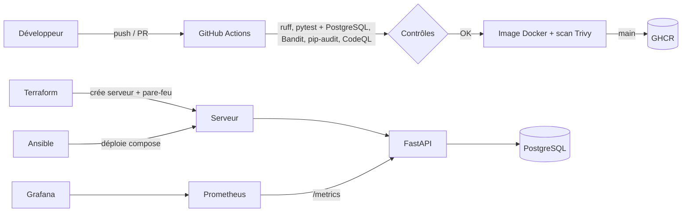

# URL Shortener : projet DevSecOps

Un raccourcisseur d'URL volontairement simple, construit pour illustrer une chaîne DevSecOps complète :
code testé, sécurisé, conteneurisé, supervisé, avec pipeline CI/CD et infrastructure décrite en code.


> Remplacer `../..` par `https://github.com/<utilisateur>/<depot>` si les badges ne s'affichent pas hors GitHub.

## Vue d'ensemble



Détails : [docs/ARCHITECTURE.md](docs/ARCHITECTURE.md) · Politique de sécurité : [SECURITY.md](SECURITY.md).

## API

| Route | Rôle |
|---|---|
| `POST /api/links` | Crée un lien court (code généré ou personnalisé). Exige `X-API-Key`. |
| `GET /{code}` | Redirige (302) vers l'URL d'origine et compte le clic |
| `GET /api/links/{code}` | Statistiques du lien |
| `GET /healthz` | Liveness : le processus répond (sans base) |
| `GET /readyz` | Readiness : la base répond |
| `GET /metrics` | Métriques Prometheus |

## Lancer le projet

En local, sans Docker (SQLite) :

```bash
python -m venv .venv && source .venv/bin/activate   # Windows : .venv\Scripts\activate
pip install -r requirements-dev.txt
pytest
uvicorn app.main:app --reload
```

Avec Docker (application + PostgreSQL, migrations appliquées au démarrage) :

```bash
docker compose up --build
curl -X POST localhost:8000/api/links -H 'content-type: application/json' \
  -H 'X-API-Key: cle-dev-locale' -d '{"url":"https://example.com"}'
```

Avec la supervision (Prometheus sur :9090, Grafana sur :3000) :

```bash
docker compose --profile monitoring up --build
```

## Qualité et sécurité (ce que la CI exécute)

```bash
ruff check . && ruff format --check .   # lint et format
pytest                                   # tests + couverture (seuil 90 %)
bandit -r app                            # analyse statique de sécurité
pip-audit -r requirements.txt            # vulnérabilités des dépendances
```

Dans la CI s'ajoutent : tests sur un vrai PostgreSQL, CodeQL, scan Trivy de l'image et de la configuration,
test de bout en bout via `docker compose`, publication de l'image sur GHCR (branche `main`), validation Ansible et Terraform.

## Déploiement

1. `infra/terraform` crée un serveur et un pare-feu (exemple Hetzner Cloud ; jeton fourni par variable d'environnement).
2. `infra/ansible` installe Docker, configure le pare-feu, dépose les secrets (fichier `.env` en 0600, valeurs chiffrées avec Ansible Vault) et lance la pile.

Ces fichiers sont validés par la CI (`terraform validate`, `ansible-lint`) mais ne sont **pas encore appliqués sur un vrai serveur**.

## Choix techniques

- **FastAPI + SQLAlchemy 2** : API typée, validation automatique, OpenAPI sur `/docs`.
- **Alembic** : le schéma est versionné ; l'image applique les migrations au démarrage.
- **Entrées** : seules les URL `http`/`https`, codes réservés interdits, domaines bloqués configurables.
- **Compteur de clics atomique** (`UPDATE ... SET clicks = clicks + 1`), testé en concurrence sur PostgreSQL.
- **302 et non 301** : un 301 serait mis en cache et les clics ne seraient plus comptés.
- **Observabilité** : journaux JSON, `X-Request-ID`, métriques par route (gabarit, pas l'URL brute), alertes Prometheus.
- **12-factor** : configuration par variables d'environnement, échec au démarrage en production si la configuration est dangereuse.

## Limites connues

- Limiteur de débit en mémoire (une seule instance) ; plusieurs instances demanderaient Redis.
- Une clé API partagée, pas de comptes utilisateurs.
- Infrastructure en code non appliquée en conditions réelles.
