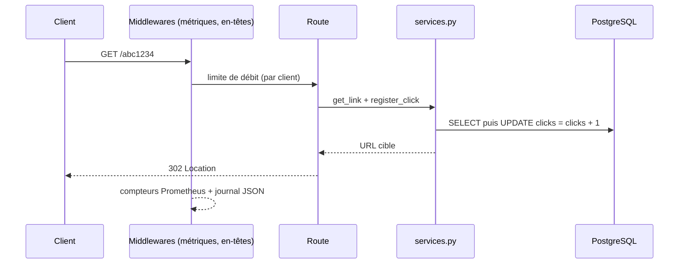

# Architecture et décisions

## Flux d'une requête

## Organisation du code

| Module | Responsabilité |
|---|---|
| `config.py` | Réglages par variables d'environnement, contrôle de la config en production |
| `schemas.py` | Validation des entrées (Pydantic) |
| `services.py` | Logique métier, sans dépendance à HTTP (réutilisable, testable seule) |
| `security.py` | Clé API, limitation de débit, en-têtes de sécurité |
| `observability.py` | Journaux JSON, métriques, identifiant de requête |
| `errors.py` | Erreurs métier et leur code HTTP |
| `main.py` | Assemblage : routes et middlewares |

La logique métier est isolée de FastAPI : `services.py` pourrait être appelé par une ligne de commande ou un autre framework.

## Décisions (ADR)

**ADR-1 : 302 plutôt que 301.** Un 301 est mis en cache durablement : les clics suivants ne passeraient plus par le service. Coût : un peu plus de trafic.

**ADR-2 : compteur de clics en SQL atomique.** `UPDATE ... clicks = clicks + 1` évite la perte de mises à jour sous concurrence, sans verrou applicatif. Vérifié par un test à 200 clics simultanés sur PostgreSQL.

**ADR-3 : limiteur de débit en mémoire.** Simple, sans dépendance, suffisant pour une instance. Limite assumée : à remplacer par Redis pour plusieurs instances.

**ADR-4 : migrations Alembic appliquées au démarrage du conteneur.** Pratique pour un service unique. Pour plusieurs réplicas, il faudrait un job de migration séparé.

**ADR-5 : `/healthz` sans base, `/readyz` avec base.** Une base indisponible ne doit pas faire redémarrer le conteneur en boucle, mais doit retirer l'instance du trafic.

**ADR-6 : étiquettes de métriques = gabarit de route.** `/{code}` et non `/abc1234` : évite l'explosion de cardinalité dans Prometheus.

**ADR-7 : échec au démarrage en production sans clé API ou avec SQLite.** Mieux vaut refuser de démarrer qu'être exposé sans protection.
